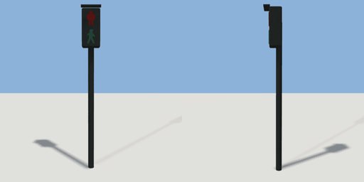

# pedestrian_signal

`asset: pedestrian_signal.yaml` · [source](../../../assets/pedestrian_signal.yaml) · `street.signal` `street.pedestrian_signal`

 

Pedestrian signal: a post with a two-lamp head facing +Z (toward the person
about to cross to it). Origin at the foot of the post. Runtimes light the red
standing figure (lamp_dont: steady for don't walk, flashing while the crossing
clears) or the green walking figure (lamp_walk) from the crossing's intervals
(meta.signal.crossing).

```yaml
place:
  pedestrian_signal: {asset: pedestrian_signal.yaml}
```

## Size

0.32 x 2.743 x 0.3 m (x, y, z); geometry (-0.16, 0, -0.05) to (0.16, 2.743, 0.25) from the origin; 364 triangles

## Parts

`post` (cylinder), `housing` (cube), `visor` (cube), `lamp_dont` (extrude), `lamp_walk` (extrude)
