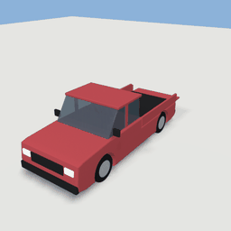
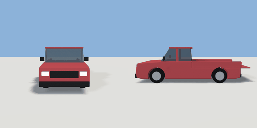

# pickup_truck

`asset: vehicles/pickup_truck.yaml` · [source](../../../assets/vehicles/pickup_truck.yaml) · `vehicle.pickup`

 

A pickup truck: long bonnet, a cab for two, and an open bed with the tailgate let down. Built
along +Z (front), origin on the ground midway between the axles, left = +X, parts in metres
(unit container, `bounds: geometry`). Things go in the bed on the `bed` surface.

```yaml
place:
  pickup_truck: {asset: vehicles/pickup_truck.yaml, params: {paint: orange, length: 5.3}}
```

## Params

| Param | Default | Choices | Notes |
| --- | --- | --- | --- |
| `length` | `5.3` |  |  |
| `width` | `1.95` |  |  |
| `height` | `1.85` |  |  |
| `wheelbase` | `3.2` |  |  |
| `wheel_r` | `0.38` |  |  |
| `tyre_w` | `0.26` |  |  |
| `belt` | `1.12` |  |  |
| `hood` | `1.05` |  |  |
| `cab_len` | `1.6` |  | from the windscreen base to the back of the cab |
| `bed` | `0.82` |  | height of the bed's floor |
| `paint` | `car_red` | car_white, silver, graphite, car_black, car_red, car_blue, car_navy, british_green, beige, orange |  |

## Size

2.27 x 1.84 x 5.84 m (x, y, z); geometry (-1.135, 0, -3.15) to (1.135, 1.84, 2.69) from the origin; 7432 triangles

## Parts

`body` (extrude), `arch_front` (cylinder), `arch_rear` (cylinder), `cab_glass` (extrude), `cab_roof` (cube), `pillar_left` (cube), `pillar_right` (cube), `bed_liner` (cube), `bed_side_left` (cube), `bed_side_right` (cube), `tailgate` (cube), `bumper_front` (cube), `bumper_rear` (cube), `grille` (cube), `headlight_left` (cube), `headlight_right` (cube), `taillight_left` (cube), `taillight_right` (cube), `mirror_left` (cube), `mirror_right` (cube), `wheel_fl` (cylinder), `wheel_fr` (cylinder), `wheel_rl` (cylinder), `wheel_rr` (cylinder), `hub_fl` (cylinder), `hub_fr` (cylinder), `hub_rl` (cylinder), `hub_rr` (cylinder)

## Surfaces

| Surface | Size (u x v, m) | Facing |
| --- | --- | --- |
| `bed` | 1.79 x 2.43 | +Y |

## Vehicle

class car, max_speed 16, turn_radius 5.5, accel 2, decel 4, wheelbase 3.2, track 1.64, clearance [5.84,2.27,1.84]
