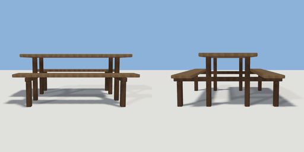

# picnic_table

`asset: picnic_table.yaml` · [source](../../../assets/picnic_table.yaml) · `furniture.picnic_table` `furniture.table`

 

A timber picnic table with bench seats on both long sides, carried on two
crossbars. Four seats (sit affordances tagged outside, so park visitors use it).
Origin: bottom centre; the table runs along X.

```yaml
place:
  picnic_table: {asset: picnic_table.yaml, params: {length: 1.8}}
```

## Params

| Param | Default | Choices | Notes |
| --- | --- | --- | --- |
| `length` | `1.8` |  |  |

## Size

1.8 x 0.77 x 1.56 m (x, y, z); geometry (-0.9, 0, -0.78) to (0.9, 0.77, 0.78) from the origin; 1404 triangles

## Parts

`top` (cube), `seat_front` (cube), `seat_back` (cube), `crossbar_left` (cube), `crossbar_right` (cube), `leg_lf` (cube), `leg_lb` (cube), `leg_rf` (cube), `leg_rb` (cube), `post_lf` (cube), `post_lb` (cube), `post_rf` (cube), `post_rb` (cube)

## Affordances

- sit at (-0.45, 0.475, 0.62) height 0.475 [seat, outside, picnic]
- sit at (0.45, 0.475, 0.62) height 0.475 [seat, outside, picnic]
- sit at (-0.45, 0.475, -0.62) height 0.475 [seat, outside, picnic]
- sit at (0.45, 0.475, -0.62) height 0.475 [seat, outside, picnic]

## Clearance

front 0.5, back 0.5
