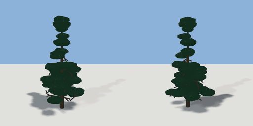

# pine_tree

`asset: pine_tree.yaml` · [source](../../../assets/pine_tree.yaml) · `vegetation.tree`

 

Pine tree - a conifer grown by space colonisation (generators/nature.py):
a straight leader with drooping boughs and flattened needle clusters.
Origin is at bottom_center. `scale` multiplies every dimension; `seed`
grows a different tree.

```yaml
place:
  pine_tree: {asset: pine_tree.yaml, params: {scale: 1, seed: 2}}
```

## Params

| Param | Default | Choices | Notes |
| --- | --- | --- | --- |
| `scale` | `1` |  |  |
| `seed` | `2` |  |  |

## Size

3.016 x 6.222 x 3.588 m (x, y, z); geometry (-1.413, -0.02, -1.926) to (1.603, 6.202, 1.662) from the origin; 4660 triangles

## Parts

`tree` (tree)
