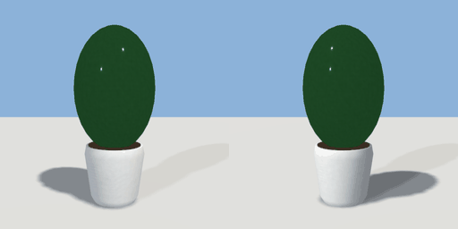

# planter

`asset: planter.yaml` · [source](../../../assets/planter.yaml) · `decor.planter` `furniture.planter`

 

Potted plant: turned ceramic pot with a leafy bush. Origin bottom_center.

```yaml
place:
  planter: {asset: planter.yaml, params: {height: 1.3}}
```

## Params

| Param | Default | Choices | Notes |
| --- | --- | --- | --- |
| `height` | `1.3` |  |  |

## Size

0.6 x 1.3 x 0.6 m (x, y, z); geometry (-0.3, 0, -0.3) to (0.3, 1.3, 0.3) from the origin; 2432 triangles

## Parts

`pot` (lathe), `soil` (cylinder), `foliage` (ellipsoid), `foliage_top` (ellipsoid)

## Clearance

front 0.1
