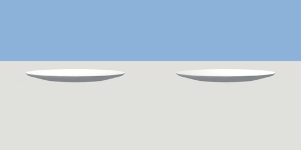

# plate

`asset: plate.yaml` · [source](../../../assets/plate.yaml) · `decor.plate`

 

A white dinner plate. Origin: the middle of its base; `center` is the middle
of the well, where food goes.

```yaml
place:
  plate: {asset: plate.yaml}
```

## Size

0.27 x 0.018 x 0.27 m (x, y, z); geometry (-0.135, 0, -0.135) to (0.135, 0.018, 0.135) from the origin; 192 triangles

## Parts

`plate` (lathe)

## Attachments

| Attachment | Position | Facing |
| --- | --- | --- |
| `center` | (0, 0.006, 0) | center |
