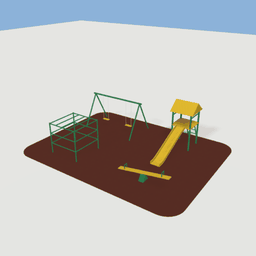
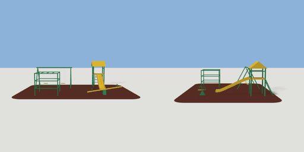

# playground

`asset: playground.yaml` · [source](../../../assets/playground.yaml) · `decor.playground`

 

A small playground on a poured-rubber pad: an A-frame swing set, a slide
with a deck and ladder, a climbing frame and a see-saw. Tubes are sweeps in
the asset frame (center: false), so the points below are where they go.
Origin: bottom centre of the pad; the swings are at the back (-Z).

```yaml
place:
  playground: {asset: playground.yaml}
```

## Size

11 x 3.04 x 8.5 m (x, y, z); geometry (-5.5, 0, -4.25) to (5.5, 3.04, 4.25) from the origin; 2740 triangles

## Parts

`pad` (extrude), `swing_leg_lf` (sweep), `swing_leg_lb` (sweep), `swing_leg_rf` (sweep), `swing_leg_rb` (sweep), `swing_bar` (sweep), `swing_chain_1a` (sweep), `swing_chain_1b` (sweep), `swing_chain_2a` (sweep), `swing_chain_2b` (sweep), `swing_seat_1` (cube), `swing_seat_2` (cube), `slide_post_1` (cylinder), `slide_post_2` (cylinder), `slide_post_3` (cylinder), `slide_post_4` (cylinder), `slide_deck` (cube), `slide_roof` (prism), `slide_rail_l` (sweep), `slide_rail_r` (sweep), `ladder_l` (sweep), `ladder_r` (sweep), `rung_1` (sweep), `rung_2` (sweep), `rung_3` (sweep), `chute` (sweep), `climb_post_1` (cylinder), `climb_post_2` (cylinder), `climb_post_3` (cylinder), `climb_post_4` (cylinder), `climb_ring_1` (sweep), `climb_ring_2` (sweep), `climb_ring_3` (sweep), `climb_top_1` (sweep), `climb_top_2` (sweep), `climb_top_3` (sweep), `seesaw_pivot` (prism), `seesaw_plank` (cube), `seesaw_handle_l` (sweep), `seesaw_handle_r` (sweep)
