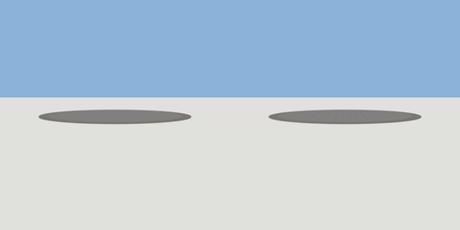

# plaza

`asset: plaza.yaml` · [source](../../../assets/plaza.yaml) · `terrain.plaza`

 

A round paved plaza: grey tiles inside a pale stone border, 10 cm high.
Origin: bottom centre; the top is walkable (scenes place things at y = thickness).

```yaml
place:
  plaza: {asset: plaza.yaml, params: {radius: 13, border: 1.5}}
```

## Params

| Param | Default | Choices | Notes |
| --- | --- | --- | --- |
| `radius` | `13` |  |  |
| `border` | `1.5` |  |  |
| `thickness` | `0.1` |  |  |

## Size

26 x 0.1 x 26 m (x, y, z); geometry (-13, 0, -13) to (13, 0.1, 13) from the origin; 3452 triangles

## Parts

`paving` (extrude), `border` (extrude)

## Surfaces

| Surface | Size (u x v, m) | Facing |
| --- | --- | --- |
| `top` | 23 x 23 | +Y |
