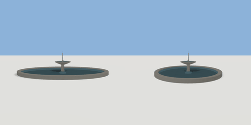

# pond

`asset: pond.yaml` · [source](../../../assets/pond.yaml) · `decor.pond` `water`

 

An oval ornamental pond: a knee-high stone rim, a dark bed, still water, and
(fountain: 1) a two-tier stone fountain in the middle with a water jet.
Origin: bottom centre of the pond; the rim is too high to step over.

```yaml
place:
  pond: {asset: pond.yaml, params: {rx: 5, rz: 3.5}}
```

## Params

| Param | Default | Choices | Notes |
| --- | --- | --- | --- |
| `rx` | `5` |  | water half-width (x) |
| `rz` | `3.5` |  | water half-depth (z) |
| `rim` | `0.45` |  | stone rim width |
| `rim_height` | `0.4` |  |  |
| `fountain` | `1` |  |  |

## Size

10.9 x 2.68 x 7.9 m (x, y, z); geometry (-5.45, 0, -3.95) to (5.45, 2.68, 3.95) from the origin; 4390 triangles

## Parts

`rim` (extrude), `bed` (extrude), `water` (water), `column` (lathe), `bowl` (lathe), `bowl_water` (lathe), `finial` (lathe), `jet` (lathe)
