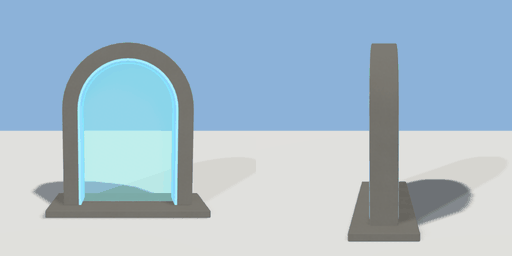

# portal

`asset: portal.yaml` · [source](../../../assets/portal.yaml) · `travel.portal`

 

A walk-through portal: a stone arch on a plinth with a glowing rim, a
translucent membrane and the destination lettered above the opening.
Walking into the opening travels (geogen/travel.py); a placement says where:

```yaml
to_hotel:
  asset: portal.yaml
  params: { label: Hotel }
  travel: { scene: hotel, spawn: entrance_spawn }
```

Origin: bottom centre; the portal faces +Z (it can be walked through both ways).

```yaml
place:
  portal: {asset: portal.yaml, params: {label: , width: 2}}
```

## Params

| Param | Default | Choices | Notes |
| --- | --- | --- | --- |
| `label` | `` | text | destination lettering ("" = none) |
| `width` | `2` |  | opening |
| `height` | `3` |  |  |
| `band` | `0.35` |  | stone around the opening |
| `depth` | `0.5` |  |  |
| `plinth` | `0.15` |  |  |
| `letter` | `0.22` |  | cap height of the lettering |
| `plaque` | `2.6` |  | name plaque width (fit it to the label) |

## Size

3.3 x 3.5 x 1.2 m (x, y, z); geometry (-1.65, 0, -0.6) to (1.65, 3.5, 0.6) from the origin; 1476 triangles

## Parts

`base` (cube), `arch` (extrude), `rim` (extrude), `membrane` (extrude), `plaque` (cube), `label_front` (text), `label_back` (text), `travel_volume` (cube)

## Light

type omni, color [0.45,0.8,1], energy 1.2, range 6, offset [0,2,0.9]

## Travel

on enter, prompt Step through, volume {center:[0,1.25,0],size:[1.7,2.2,0.3]}
