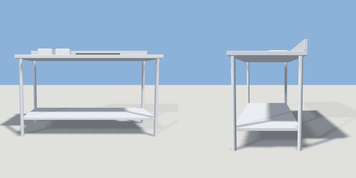

# prep_counter

`asset: prep_counter.yaml` · [source](../../../assets/prep_counter.yaml) · `kitchen.prep_counter` `furniture.counter`

 

A stainless prep table with an undershelf, a chopping board and a few tubs.
Against a wall (back at -Z); staff work from the front (+Z).

```yaml
place:
  prep_counter: {asset: prep_counter.yaml, params: {width: 1.6}}
```

## Params

| Param | Default | Choices | Notes |
| --- | --- | --- | --- |
| `width` | `1.6` |  |  |

## Size

1.6 x 1 x 0.7 m (x, y, z); geometry (-0.8, 0, -0.35) to (0.8, 1, 0.35) from the origin; 840 triangles

## Parts

`top` (cube), `upstand` (cube), `undershelf` (cube), `leg_1` (cylinder), `leg_2` (cylinder), `leg_3` (cylinder), `leg_4` (cylinder), `board` (cube), `tub_1` (cube), `tub_2` (cube)

## Affordances

stand at (0, 0, 0.75) [staff, cook]

## Clearance

front 0.9
