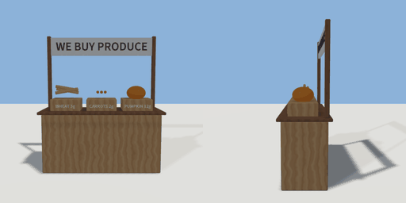

# produce_counter

`asset: produce_counter.yaml` · [source](../../../assets/produce_counter.yaml) · `farm.counter`

 

A produce counter that buys what a farm grows: a wooden market counter with three crates
on it (wheat, carrots, pumpkin) under a WE BUY sign. Use a crate to sell one of that crop
from the inventory for `<crop>_price` gold (into the seller's purse, actor.gold);
refused when there is none to sell. Origin: on the ground at the counter's middle; the
seller stands in front (+Z).

```yaml
place:
  produce_counter: {asset: produce_counter.yaml, params: {wheat_price: 3, carrot_price: 2}, state: {sell_wheat: selling}}
```

## Params

| Param | Default | Choices | Notes |
| --- | --- | --- | --- |
| `wheat_price` | `3` |  |  |
| `carrot_price` | `2` |  |  |
| `pumpkin_price` | `12` |  |  |

## Size

1.9 x 2.14 x 0.7 m (x, y, z); geometry (-0.95, 0, -0.35) to (0.95, 2.14, 0.35) from the origin; 9724 triangles

## Parts

`counter` (cube), `top` (cube), `post_l` (cube), `post_r` (cube), `sign` (cube), `lettering` (text), `crate_wheat` (cube), `label_wheat` (text), `crate_carrot` (cube), `label_carrot` (text), `crate_pumpkin` (cube), `label_pumpkin` (text), `wheat_1` (cylinder), `wheat_2` (cylinder), `wheat_3` (cylinder), `carrot_1` (cone), `carrot_2` (cone), `carrot_3` (cone), `pumpkin_1` (ellipsoid)

## Interactions

- sell_wheat: ready* -> selling, selling (then ready after 0.2 s) (* initial)
- sell_carrot: ready* -> selling, selling (then ready after 0.2 s) (* initial)
- sell_pumpkin: ready* -> selling, selling (then ready after 0.2 s) (* initial)
