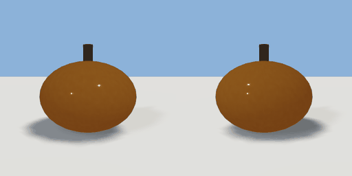

# pumpkin

`asset: pumpkin.yaml` · [source](../../../assets/pumpkin.yaml) · `prop.crop`

 

A pumpkin: a squashed orange ball with a stalk. The body of items/pumpkin.yaml (a
carryable physics prop). Origin: bottom centre.

```yaml
place:
  pumpkin: {asset: pumpkin.yaml}
```

## Size

0.3 x 0.27 x 0.3 m (x, y, z); geometry (-0.15, 0, -0.15) to (0.15, 0.27, 0.15) from the origin; 1008 triangles

## Parts

`fruit` (ellipsoid), `stalk` (cylinder)
