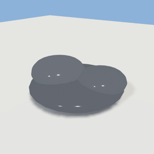
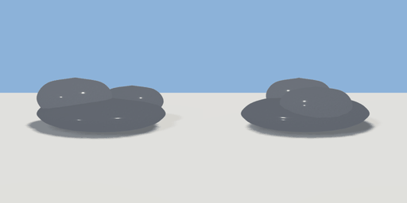

# rain_cloud

`asset: rain_cloud.yaml` · [source](../../../assets/rain_cloud.yaml) · `decor.weather`

 

A low cloud with its own shower: rain falls from a box under it to the ground.
Bind or set `belly.running` to stop it. Origin: on the ground under the cloud.

```yaml
place:
  rain_cloud: {asset: rain_cloud.yaml, params: {height: 6}}
```

## Params

| Param | Default | Choices | Notes |
| --- | --- | --- | --- |
| `height` | `6` |  | underside of the cloud above the ground |

## Size

5.55 x 2.1 x 5.5 m (x, y, z); geometry (-2.75, 6, -2.75) to (2.8, 8.1, 2.75) from the origin; 3456 triangles

## Parts

`belly` (lathe), `top_a` (lathe), `top_b` (lathe)
