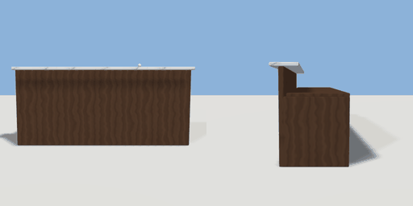

# reception_desk

`asset: reception_desk.yaml` · [source](../../../assets/reception_desk.yaml) · `furniture.desk` `furniture.reception_desk`

 

Reception counter: a raised customer-side transaction ledge over a lower
work desk, with a marble top and a modesty panel. Origin bottom_center;
guests stand on the +Z side, staff sit behind (-Z).

```yaml
place:
  reception_desk: {asset: reception_desk.yaml, params: {width: 2.4, depth: 0.8}}
```

## Params

| Param | Default | Choices | Notes |
| --- | --- | --- | --- |
| `width` | `2.4` |  |  |
| `depth` | `0.8` |  |  |

## Size

2.4 x 1.1 x 0.8 m (x, y, z); geometry (-1.22, 0, -0.4) to (1.22, 1.14, 0.42) from the origin; 660 triangles

## Parts

`front_panel` (cube), `ledge` (cube), `work_top` (cube), `end_left` (cube), `end_right` (cube), `bell` (sphere)

## Attachments

| Attachment | Position | Facing |
| --- | --- | --- |
| `staff` | (0, 0, -0.85) | north |
| `guest` | (0, 0, 0.9) | south |

## Affordances

stand at (1.65, 0, 0.1) [staff, desk]

## Clearance

front 1, back 0.9
