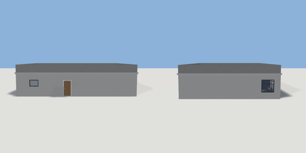

# restaurant_building

`asset: restaurant_building.yaml` · [source](../../../assets/restaurant_building.yaml) · `building.restaurant`

 

A corner restaurant: a dining room and a bar at the front (street door on
the south side), the kitchen and two restrooms behind, and a back door out
of the kitchen. One storey, stucco front, flat roof. Rooms are furnished
from their archetypes (room_types/dining_room, bar, restaurant_kitchen, restroom).

```yaml
place:
  restaurant_building: {asset: restaurant_building.yaml}
```

## Size

16.3 x 4 x 12.8 m (x, y, z); geometry (-8.29, -0.05, -8) to (8.29, 4.25, 8) from the origin; 123128 triangles

## Rooms

dining (dining_room), bar (bar), kitchen (restaurant_kitchen), restroom_a (restroom), restroom_b (restroom)
