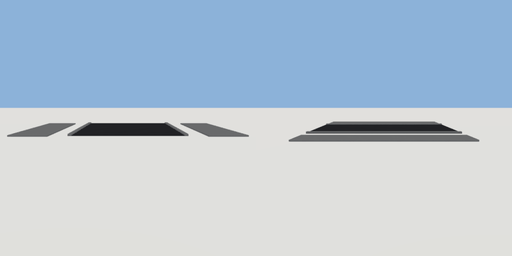

# road_section

`asset: road_section.yaml` · [source](../../../assets/road_section.yaml) · `street.road`

 

Road section with sidewalks on both sides
Oriented along Z axis (road runs north-south)
Origin is at bottom_center

```yaml
place:
  road_section: {asset: road_section.yaml, params: {width: 12, thickness: 0.15}}
```

## Params

| Param | Default | Choices | Notes |
| --- | --- | --- | --- |
| `width` | `12` |  | across the whole section (sidewalk + road + sidewalk) |
| `thickness` | `0.15` |  | vertical slab height |
| `length` | `10` |  | along the road |

## Size

12 x 0.15 x 10 m (x, y, z); geometry (-7.2, -0.049, -5) to (7.2, 0.128, 5) from the origin; 924 triangles

## Parts

`sidewalk_left` (cube), `road` (cube), `sidewalk_right` (cube), `curb_left` (cube), `curb_right` (cube)
