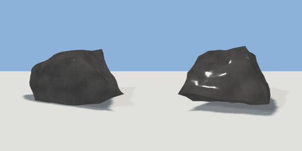

# rock_large

`asset: rock_large.yaml` · [source](../../../assets/rock_large.yaml) · `terrain.rock`

 

large rock - a random convex cage, subdivided with creases and noise-displaced
(primitive: rock, generators/nature.py). Origin at bottom_center, sunk a little
into the ground; `seed` gives a different stone.

```yaml
place:
  rock_large: {asset: rock_large.yaml, params: {width: 1.2, height: 0.9}}
```

## Params

| Param | Default | Choices | Notes |
| --- | --- | --- | --- |
| `width` | `1.2` |  |  |
| `height` | `0.9` |  |  |
| `depth` | `1` |  |  |
| `seed` | `11` |  |  |

## Size

1.2 x 0.9 x 1 m (x, y, z); geometry (-0.607, 0.056, -0.485) to (0.627, 0.736, 0.483) from the origin; 1280 triangles

## Parts

`body` (rock)
