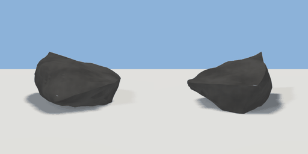

# rock_medium

`asset: rock_medium.yaml` · [source](../../../assets/rock_medium.yaml) · `terrain.rock`

 

medium rock - a random convex cage, subdivided with creases and noise-displaced
(primitive: rock, generators/nature.py). Origin at bottom_center, sunk a little
into the ground; `seed` gives a different stone.

```yaml
place:
  rock_medium: {asset: rock_medium.yaml, params: {width: 0.6, height: 0.45}}
```

## Params

| Param | Default | Choices | Notes |
| --- | --- | --- | --- |
| `width` | `0.6` |  |  |
| `height` | `0.45` |  |  |
| `depth` | `0.55` |  |  |
| `seed` | `3` |  |  |

## Size

0.6 x 0.45 x 0.55 m (x, y, z); geometry (-0.326, 0.025, -0.275) to (0.3, 0.371, 0.275) from the origin; 1536 triangles

## Parts

`body` (rock)
