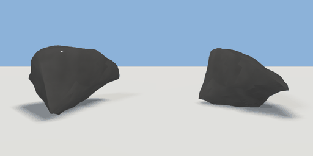

# rock_small

`asset: rock_small.yaml` · [source](../../../assets/rock_small.yaml) · `terrain.rock`

 

small rock - a random convex cage, subdivided with creases and noise-displaced
(primitive: rock, generators/nature.py). Origin at bottom_center, sunk a little
into the ground; `seed` gives a different stone.

```yaml
place:
  rock_small: {asset: rock_small.yaml, params: {width: 0.3, height: 0.2}}
```

## Params

| Param | Default | Choices | Notes |
| --- | --- | --- | --- |
| `width` | `0.3` |  |  |
| `height` | `0.2` |  |  |
| `depth` | `0.25` |  |  |
| `seed` | `5` |  |  |

## Size

0.3 x 0.2 x 0.25 m (x, y, z); geometry (-0.152, -0.009, -0.128) to (0.154, 0.185, 0.127) from the origin; 1408 triangles

## Parts

`body` (rock)
