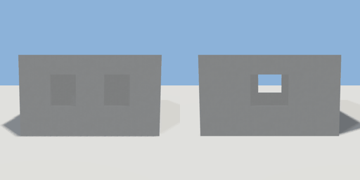

# room

`asset: room.yaml` · [source](../../../assets/room.yaml) · `room.demo`

 

Single room with a door and windows, built as a one-room floor plan (clean
wall corners, finishes, a hinged door). Origin at the centre of the floor.

```yaml
place:
  room: {asset: room.yaml}
```

## Size

4.4 x 2.55 x 4.4 m (x, y, z); geometry (-2.2, -0.05, -2.218) to (2.2, 2.5, 2.2) from the origin; 2748 triangles

## Rooms

room (room)

## Surfaces

| Surface | Size (u x v, m) | Facing |
| --- | --- | --- |
| `room.floor` | 4 x 4 | +Y |
| `room.ceiling` | 4 x 4 | -Y |
| `room.north_wall` | 4 x 2.3 | -Z |
| `room.south_wall` | 4 x 2.3 | +Z |
| `room.east_wall` | 4 x 2.3 | -X |
| `room.west_wall` | 4 x 2.3 | +X |
| `room.north_exterior` | 4 x 2.3 | +Z |
| `room.south_exterior` | 4 x 2.3 | -Z |
| `room.east_exterior` | 4 x 2.3 | +X |
| `room.west_exterior` | 4 x 2.3 | -X |
