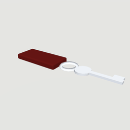
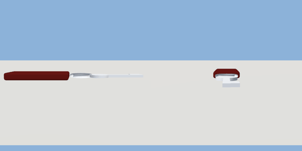

# room_key

`asset: room_key.yaml` · [source](../../../assets/room_key.yaml) · `prop.key`

 

A room key on a red fob, to pick up. Taking it gives the item
items/room_key.yaml (pickup: room_key). Origin: bottom centre; the key
points along +X.

```yaml
place:
  room_key: {asset: room_key.yaml, state: taken}
```

## Size

0.155 x 0.008 x 0.032 m (x, y, z); geometry (-0.09, 0, -0.016) to (0.065, 0.008, 0.016) from the origin; 660 triangles

## Parts

`fob` (cube), `ring` (torus), `bow` (cylinder), `shaft` (cube), `bit` (cube)

## Interactions

pickup: here* -> taken, taken (* initial; shows/hides fob, ring, bow, shaft, bit)
