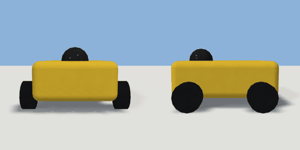

# rover

`asset: rover.yaml` · [source](../../../assets/rover.yaml) · `prop.rover`

 

A little yellow delivery rover on four wheels with a sensor dome: a walking item for
tracks (items/rover.yaml). Origin: bottom centre; it drives toward +Z.

```yaml
place:
  rover: {asset: rover.yaml}
```

## Size

0.44 x 0.265 x 0.46 m (x, y, z); geometry (-0.22, 0.025, -0.23) to (0.22, 0.29, 0.23) from the origin; 780 triangles

## Parts

`body` (cube), `dome` (sphere), `wheel_l` (cylinder), `wheel_r` (cylinder)
