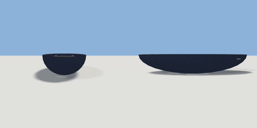

# rowing_boat

`asset: rowing_boat.yaml` · [source](../../../assets/rowing_boat.yaml) · `vehicle.boat` `decor.boat`

 

A small clinker-style rowing boat: a painted hull (a half ellipsoid, hollowed),
a wooden rubbing strake, two thwarts and a stern bench, and a pair of oars
shipped along the seats. Origin: the middle of the boat on the waterline
(the hull draws `draft` below it); the bow points along +Z.

```yaml
place:
  rowing_boat: {asset: rowing_boat.yaml, params: {length: 3.4, beam: 1.3}}
```

## Params

| Param | Default | Choices | Notes |
| --- | --- | --- | --- |
| `length` | `3.4` |  |  |
| `beam` | `1.3` |  |  |
| `draft` | `0.2` |  | hull below the waterline |
| `freeboard` | `0.4` |  | hull above it |
| `hull_color` | `paint_navy` | text |  |

## Size

1.3 x 0.6 x 3.4 m (x, y, z); geometry (-0.65, -0.2, -1.7) to (0.65, 0.4, 1.7) from the origin; 1768 triangles

## Parts

`hull` (ellipsoid), `hull_top` (cube), `hull_hollow` (ellipsoid), `thwart_fore` (cube), `thwart_aft` (cube), `stern_bench` (cube), `floorboards` (cube), `oar_left` (cylinder), `blade_left` (cube), `oar_right` (cylinder), `blade_right` (cube)
