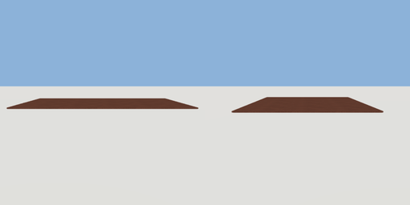

# rug

`asset: rug.yaml` · [source](../../../assets/rug.yaml) · `furniture.rug`

 

Low-pile area rug with a bound edge. Origin bottom_center.

```yaml
place:
  rug: {asset: rug.yaml, params: {width: 2, depth: 1.4}}
```

## Params

| Param | Default | Choices | Notes |
| --- | --- | --- | --- |
| `width` | `2` |  |  |
| `depth` | `1.4` |  |  |

## Size

2 x 0.012 x 1.4 m (x, y, z); geometry (-1, 0, -0.7) to (1, 0.012, 0.7) from the origin; 572 triangles

## Parts

`rug` (extrude)
