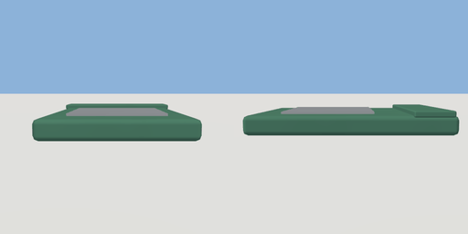

# seed_packet

`asset: seed_packet.yaml` · [source](../../../assets/seed_packet.yaml) · `prop.seeds`

 

A packet of seeds. Lying face up, a flat paper envelope in the crop's colour with a white
label and a sealed flap at the top end; a carryable physics prop. The farm's seed machine
hands them out (items/<crop>_seeds.yaml), and dropping one on a plot plants it.
Origin: bottom centre; the flap is at -Z.

```yaml
place:
  seed_packet: {asset: seed_packet.yaml, params: {colour: british_green}}
```

## Params

| Param | Default | Choices | Notes |
| --- | --- | --- | --- |
| `colour` | `british_green` | text |  |

## Size

0.09 x 0.015 x 0.13 m (x, y, z); geometry (-0.045, 0, -0.065) to (0.045, 0.015, 0.065) from the origin; 228 triangles

## Parts

`envelope` (cube), `flap` (cube), `label` (cube)
