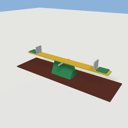
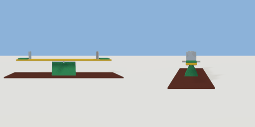

# seesaw

`asset: seesaw.yaml` · [source](../../../assets/seesaw.yaml) · `play.seesaw` `mechanism.seesaw`

 

A playground seesaw: a plank tipping on a hinge. A mechanism with one body on a free
hinge with limits: something heavy on one end puts it down (a dropped prop; the player
weighs nothing, being kinematic). The plank runs along X. Origin: bottom centre of the
fulcrum.

```yaml
place:
  seesaw: {asset: seesaw.yaml, params: {length: 3.6, tilt: 22}}
```

## Params

| Param | Default | Choices | Notes |
| --- | --- | --- | --- |
| `length` | `3.6` |  |  |
| `tilt` | `22` |  | degrees each way before an end meets the ground |

## Size

4.2 x 0.94 x 1.2 m (x, y, z); geometry (-2.1, 0, -0.6) to (2.1, 0.94, 0.6) from the origin; 608 triangles

## Parts

`pad` (cube), `fulcrum` (prism), `pin` (cylinder), `board` (cube), `seat` (cube), `handle` (cube)
