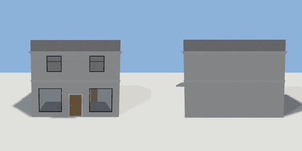

# shop

`asset: shop.yaml` · [source](../../../assets/shop.yaml) · `building.shop`

 

Corner shop: a double-height storefront on the ground floor with a stock
room behind, and a flat above. Front (storefront and door) faces +Z.

```yaml
place:
  shop: {asset: shop.yaml}
```

## Size

8.3 x 6.95 x 9.3 m (x, y, z); geometry (-4.29, -0.05, -4.79) to (4.29, 7.2, 6.25) from the origin; 6140 triangles

## Rooms

shop (shop), stock (storage), flat (living_room)
