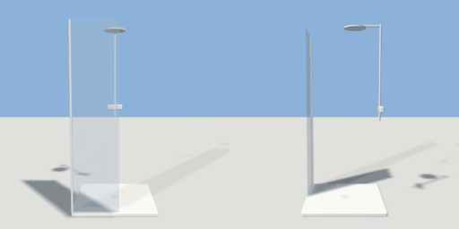

# shower

`asset: shower.yaml` · [source](../../../assets/shower.yaml) · `bathroom.shower`

 

Shower: low ceramic tray, fixed glass screen on part of the front, chrome
riser rail with a rain head and mixer on the back wall. Back against the
wall (-Z), origin bottom_center.

```yaml
place:
  shower: {asset: shower.yaml, params: {width: 0.9, depth: 0.9}}
```

## Params

| Param | Default | Choices | Notes |
| --- | --- | --- | --- |
| `width` | `0.9` |  |  |
| `depth` | `0.9` |  |  |
| `height` | `2.05` |  |  |

## Size

0.9 x 2.05 x 0.9 m (x, y, z); geometry (-0.45, 0, -0.45) to (0.45, 2.05, 0.45) from the origin; 1232 triangles

## Parts

`tray` (extrude), `drain` (cylinder), `screen` (cube), `screen_profile` (cube), `riser` (cylinder), `arm` (cube), `head` (cylinder), `mixer` (cube)

## Clearance

front 0.6
