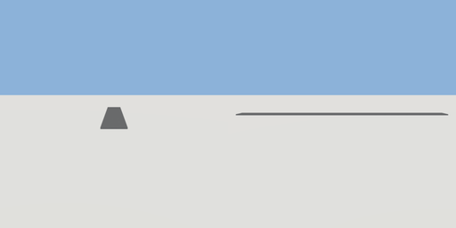

# sidewalk

`asset: sidewalk.yaml` · [source](../../../assets/sidewalk.yaml) · `street.sidewalk`

 

Sidewalk - concrete walkway
Runs parallel to road

```yaml
place:
  sidewalk: {asset: sidewalk.yaml, params: {width: 2, thickness: 0.12}}
```

## Params

| Param | Default | Choices | Notes |
| --- | --- | --- | --- |
| `width` | `2` |  |  |
| `thickness` | `0.12` |  |  |
| `length` | `24` |  |  |

## Size

2 x 0.12 x 24 m (x, y, z); geometry (-1, 0, -12) to (1, 0.12, 12) from the origin; 12 triangles

## Parts

`surface` (cube)
