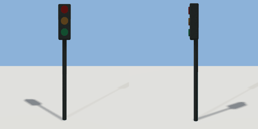

# signal_head

`asset: signal_head.yaml` · [source](../../../assets/signal_head.yaml) · `street.signal`

 

Traffic signal: a post with a three-lamp head facing +Z (toward the traffic it
controls). Origin at the foot of the post. Runtimes light one lamp (lamp_red,
lamp_amber, lamp_green) from the intersection's cycle (meta.signal).

```yaml
place:
  signal_head: {asset: signal_head.yaml}
```

## Size

0.34 x 3.3 x 0.275 m (x, y, z); geometry (-0.17, 0, -0.07) to (0.17, 3.3, 0.205) from the origin; 676 triangles

## Parts

`post` (cylinder), `housing` (cube), `lamp_red` (cylinder), `lamp_amber` (cylinder), `lamp_green` (cylinder)
