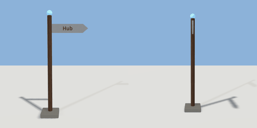

# signpost

`asset: signpost.yaml` · [source](../../../assets/signpost.yaml) · `decor.signpost`

 

A fingerpost: a post with up to four arrow boards, each lettered on both
faces and pointing along a compass bearing (0 = north / +Z, 90 = east / +X).
An arm whose label is "" is left off.

```yaml
sign:
  asset: signpost.yaml
  params: { arm1: Hotel, dir1: 90, arm2: Park, dir2: 200 }
```

Origin: the foot of the post.

```yaml
place:
  signpost: {asset: signpost.yaml, params: {arm1: Hub, arm2: }}
```

## Params

| Param | Default | Choices | Notes |
| --- | --- | --- | --- |
| `arm1` | `Hub` | text |  |
| `arm2` | `` | text |  |
| `arm3` | `` | text |  |
| `arm4` | `` | text |  |
| `dir1` | `90` |  |  |
| `dir2` | `270` |  |  |
| `dir3` | `0` |  |  |
| `dir4` | `180` |  |  |
| `post_height` | `2.7` |  |  |
| `arm_length` | `1` |  |  |
| `letter` | `0.1` |  |  |

## Size

1.31 x 2.96 x 0.5 m (x, y, z); geometry (-0.25, 0, -0.25) to (1.06, 2.96, 0.25) from the origin; 1986 triangles

## Parts

`foot` (cube), `post` (cylinder), `finial` (sphere), `arm1` (extrude), `arm1_front` (text), `arm1_back` (text), `arm2` (extrude), `arm2_front` (text), `arm2_back` (text), `arm3` (extrude), `arm3_front` (text), `arm3_back` (text), `arm4` (extrude), `arm4_front` (text), `arm4_back` (text)
