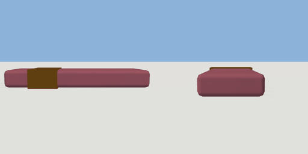

# snack_bar

`asset: snack_bar.yaml` · [source](../../../assets/snack_bar.yaml) · `prop.snack`

 

A chocolate bar. Lying flat, a wrapper with a gold band across it; a carryable
physics prop; vending_machine.yaml hands them out (items/chocolate_bar.yaml).
Origin: bottom centre; the bar runs along X.

```yaml
place:
  snack_bar: {asset: snack_bar.yaml, params: {colour: maroon}}
```

## Params

| Param | Default | Choices | Notes |
| --- | --- | --- | --- |
| `colour` | `maroon` | text |  |

## Size

0.15 x 0.02 x 0.054 m (x, y, z); geometry (-0.075, -0.001, -0.027) to (0.075, 0.019, 0.027) from the origin; 120 triangles

## Parts

`wrapper` (cube), `band` (cube)
