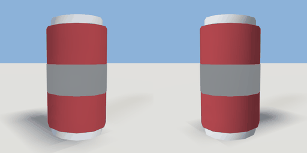

# soda_can

`asset: soda_can.yaml` · [source](../../../assets/soda_can.yaml) · `prop.can`

 

A drink can. A tinted aluminium body with a silver lid and base, and a band round the
middle; a carryable physics prop; vending_machine.yaml hands them out
(items/cola.yaml, items/lemonade.yaml). Origin: bottom centre.

```yaml
place:
  soda_can: {asset: soda_can.yaml, params: {colour: car_red, band: paint_white}}
```

## Params

| Param | Default | Choices | Notes |
| --- | --- | --- | --- |
| `colour` | `car_red` | text |  |
| `band` | `paint_white` | text |  |

## Size

0.067 x 0.122 x 0.067 m (x, y, z); geometry (-0.033, 0, -0.033) to (0.033, 0.122, 0.033) from the origin; 192 triangles

## Parts

`body` (cylinder), `band` (cylinder), `base` (cylinder), `lid` (cylinder)
