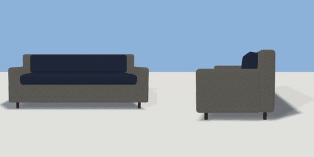

# sofa

`asset: sofa.yaml` · [source](../../../assets/sofa.yaml) · `furniture.sofa`

 

Three-seat sofa: upholstered base and arms, seat and back cushions on low
wooden legs. Origin bottom_center, seats face +Z.

```yaml
place:
  sofa: {asset: sofa.yaml, params: {width: 2, depth: 0.9}}
```

## Params

| Param | Default | Choices | Notes |
| --- | --- | --- | --- |
| `width` | `2` |  |  |
| `depth` | `0.9` |  |  |
| `height` | `0.82` |  |  |
| `seats` | `3` |  |  |

## Size

2 x 0.82 x 0.9 m (x, y, z); geometry (-1, 0, -0.45) to (1, 0.82, 0.45) from the origin; 1992 triangles

## Parts

`base` (cube), `back` (cube), `arm_left` (cube), `arm_right` (cube), `seat_cushions` (cube), `back_cushions` (cube), `leg_fl` (cylinder), `leg_fr` (cylinder), `leg_bl` (cylinder), `leg_br` (cylinder)

## Surfaces

| Surface | Size (u x v, m) | Facing |
| --- | --- | --- |
| `seat` | 1.66 x 0.7 | +Y |

## Affordances

- sit at (-0.56, 0.5, 0.1) height 0.5 [seat, comfy]
- sit at (0, 0.5, 0.1) height 0.5 [seat, comfy]
- sit at (0.56, 0.5, 0.1) height 0.5 [seat, comfy]

## Clearance

front 0.6
