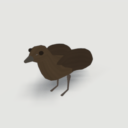
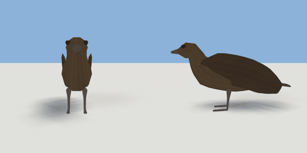

# sparrow

`asset: characters/sparrow.yaml` · [source](../../../assets/characters/sparrow.yaml) · `npc.body` `animal.bird`

 

A small bird: a sparrow by default, other small birds from its params. Wings,
legs and tail are ring-lofted chains on the bird skeleton
(assets/skeletons/bird.yaml), like the cat's body; one closed skinned mesh.
It stands, pecks, hops and flies, all declared below. Faces +Z; origin on the
ground under its feet.

Ring frames (front: [0, 1, 0]): the trunk, tail and wings have rx across them
(a wing's rx is its chord) and rz up (a wing's thickness).

```yaml
place:
  sparrow: {asset: characters/sparrow.yaml, params: {plumage: blackbird, size: 1}}
```

## Params

| Param | Default | Choices | Notes |
| --- | --- | --- | --- |
| `size` | `1` |  | 1: a sparrow (15 cm); a pigeon is about 2 |
| `plumage` | `sparrow` | sparrow, robin, tit, pigeon, blackbird |  |

## Size

0.049 x 0.101 x 0.197 m (x, y, z); geometry (-0.025, 0.001, -0.099) to (0.025, 0.101, 0.078) from the origin; 1582 triangles

## Poses

fly, stand

## Clips

fly, idle, pose_fly, pose_stand, walk
