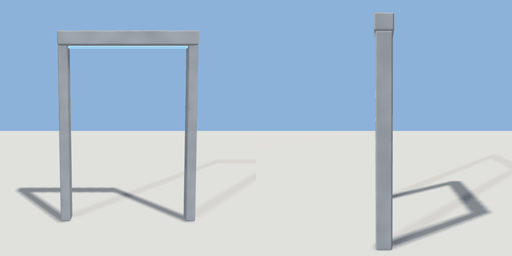

# spawner

`asset: spawner.yaml` · [source](../../../assets/spawner.yaml) · `machine.spawner`

 

A spawner arch: two posts and a lintel with a glowing strip, and a source of spawned items
(geogen.flows) between the posts. `item` is the item file it makes, `rate` how many a
second; `drop` lifts the spawn point (a belt's height, so it feeds a conveyor's back end).
It starts `initial: running`, or stopped until a rule or wire starts it. Origin: on the
ground between the posts; items come out facing +Z.

```yaml
place:
  spawner: {asset: spawner.yaml, params: {item: items/parcel.yaml, rate: 0.5}}
```

## Params

| Param | Default | Choices | Notes |
| --- | --- | --- | --- |
| `item` | `items/parcel.yaml` | text |  |
| `rate` | `0.5` |  |  |
| `drop` | `0` |  |  |
| `initial` | `running` | text |  |
| `max_alive` | `20` |  |  |
| `count` | `0` |  |  |
| `width` | `1.3` |  |  |
| `height` | `1.8` |  |  |

## Size

1.4 x 1.94 x 0.16 m (x, y, z); geometry (-0.7, 0, -0.08) to (0.7, 1.94, 0.08) from the origin; 528 triangles

## Parts

`post_l` (cube), `post_r` (cube), `lintel` (cube), `strip` (cube)

## Attachments

| Attachment | Position | Facing |
| --- | --- | --- |
| `mouth` | (0, 0, 0) | center |
