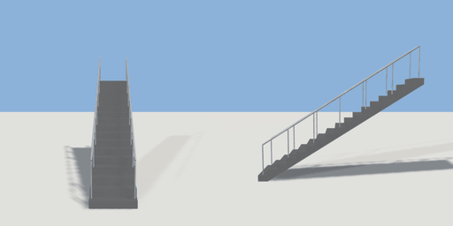

# staircase

`asset: staircase.yaml` · [source](../../../assets/staircase.yaml) · `architecture.stairs`

 

Parametric staircase: straight, L-shaped (quarter landing) or spiral, with
handrails. The step count follows from rise / max_riser, so any rise stays
climbable. Climbs toward -Z; origin at the bottom centre.

```yaml
place:
  staircase: {asset: staircase.yaml, params: {rise: 3, width: 1.1}}
```

## Params

| Param | Default | Choices | Notes |
| --- | --- | --- | --- |
| `rise` | `3` |  |  |
| `width` | `1.1` |  |  |

## Size

1.1 x 3.92 x 4.767 m (x, y, z); geometry (-0.55, 0, -2.38) to (0.55, 3.919, 2.38) from the origin; 792 triangles

## Parts

`stairs` (stairs)
