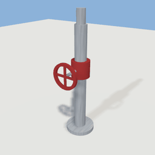
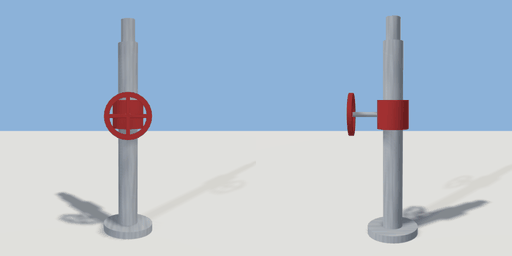

# steam_vent

`asset: steam_vent.yaml` · [source](../../../assets/steam_vent.yaml) · `decor.steam` `switch.valve`

 

A steam pipe with a handwheel: turn it (E) to shut off the hissing nozzle.
Origin: bottom centre.

```yaml
place:
  steam_vent: {asset: steam_vent.yaml, state: closed}
```

## Size

0.36 x 1.51 x 0.485 m (x, y, z); geometry (-0.18, 0, -0.18) to (0.18, 1.51, 0.305) from the origin; 840 triangles

## Parts

`flange` (cylinder), `pipe` (cylinder), `valve_body` (cylinder), `stem` (extrude), `wheel` (extrude), `spoke_a` (cube), `spoke_b` (cube), `nozzle` (cylinder)

## Interactions

valve: open* -> closed, closed -> open (* initial; rotates wheel, spoke_a, spoke_b)

## Clearance

front 0.7
