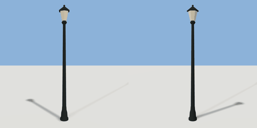

# street_lamp

`asset: street_lamp.yaml` · [source](../../../assets/street_lamp.yaml) · `street.lamp`

 

Street lamp: a tapered cast-iron post with a glass lantern. Origin at the
bottom centre; parts in metres (the container is a unit, `scale` scales it).
The light is `auto: night`: runtimes switch it (and the lantern's glow) on
after dark.

```yaml
place:
  street_lamp: {asset: street_lamp.yaml, params: {scale: 1}}
```

## Params

| Param | Default | Choices | Notes |
| --- | --- | --- | --- |
| `scale` | `1` |  |  |

## Size

0.398 x 4.61 x 0.46 m (x, y, z); geometry (-0.199, 0, -0.23) to (0.199, 4.61, 0.23) from the origin; 708 triangles

## Parts

`base` (lathe), `post` (lathe), `collar` (lathe), `lantern` (lathe), `roof` (lathe), `finial` (sphere)

## Light

type omni, color [1,0.82,0.58], energy 2.5, range 13, offset [0,4.12,0], auto night
