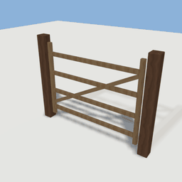
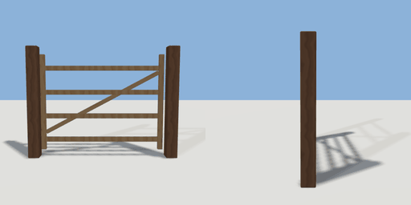

# swing_gate

`asset: swing_gate.yaml` · [source](../../../assets/swing_gate.yaml) · `decor.gate` `mechanism.gate`

 

A field gate on a free hinge: walk into it and it swings open. A mechanism with one body
(the leaf) on a hinge with limits, no motor and no interaction: physics does it. The
opening is `width` between the posts; the hinge post is at -X. Origin: bottom centre of
the opening, the leaf closed across it (along X).

```yaml
place:
  swing_gate: {asset: swing_gate.yaml, params: {width: 1.6, height: 1.2}}
```

## Params

| Param | Default | Choices | Notes |
| --- | --- | --- | --- |
| `width` | `1.6` |  | clear opening between the posts |
| `height` | `1.2` |  |  |
| `swing` | `110` |  | degrees it opens to, each way |

## Size

1.88 x 1.4 x 0.14 m (x, y, z); geometry (-0.94, 0, -0.07) to (0.94, 1.4, 0.07) from the origin; 1356 triangles

## Parts

`post_hinge` (cube), `post_latch` (cube), `stile_hinge` (cube), `stile_latch` (cube), `bar` (cube), `brace` (cube)
