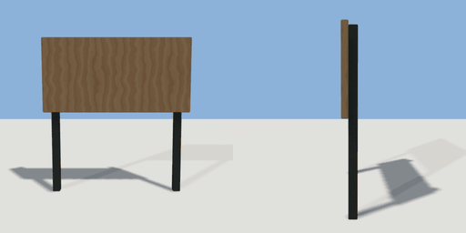

# switch_board

`asset: switch_board.yaml` · [source](../../../assets/switch_board.yaml) · `decor.board`

 

A board on two posts for wall switches.
Origin: bottom centre; the face is on +Z (switches go on z = depth / 2).

```yaml
place:
  switch_board: {asset: switch_board.yaml, params: {width: 1.6, height: 1.7}}
```

## Params

| Param | Default | Choices | Notes |
| --- | --- | --- | --- |
| `width` | `1.6` |  |  |
| `height` | `1.7` |  | top of the panel |
| `panel` | `0.8` |  | panel height |
| `depth` | `0.06` |  |  |

## Size

1.6 x 1.7 x 0.14 m (x, y, z); geometry (-0.8, 0, -0.11) to (0.8, 1.7, 0.03) from the origin; 324 triangles

## Parts

`panel` (cube), `post_left` (cube), `post_right` (cube)
