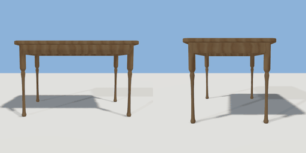

# table

`asset: table.yaml` · [source](../../../assets/table.yaml) · `furniture.table`

 

Dining table: rounded tabletop, apron frame and turned legs.
Origin is at bottom_center of bounding box. Front of the table is +Z.

```yaml
place:
  table: {asset: table.yaml, params: {width: 1.2, height: 0.75}}
```

## Params

| Param | Default | Choices | Notes |
| --- | --- | --- | --- |
| `width` | `1.2` |  |  |
| `height` | `0.75` |  |  |
| `depth` | `0.8` |  |  |
| `top_thickness` | `0.035` |  |  |
| `apron_height` | `0.09` |  |  |
| `leg_width` | `0.06` |  |  |
| `leg_inset` | `0.07` |  | leg centre distance from the tabletop edge |

## Size

1.2 x 0.75 x 0.8 m (x, y, z); geometry (-0.6, 0, -0.4) to (0.6, 0.75, 0.4) from the origin; 2540 triangles

## Parts

`top` (extrude), `apron_front` (cube), `apron_back` (cube), `apron_left` (cube), `apron_right` (cube), `leg_front_left` (lathe), `leg_front_right` (lathe), `leg_back_left` (lathe), `leg_back_right` (lathe)

## Attachments

| Attachment | Position | Facing |
| --- | --- | --- |
| `seat_front` | (0, 0, 0.8) | center |
| `seat_back` | (0, 0, -0.8) | center |
| `seat_left` | (-1, 0, 0) | center |
| `seat_right` | (1, 0, 0) | center |

## Surfaces

| Surface | Size (u x v, m) | Facing |
| --- | --- | --- |
| `top` | 1.2 x 0.8 | +Y |
