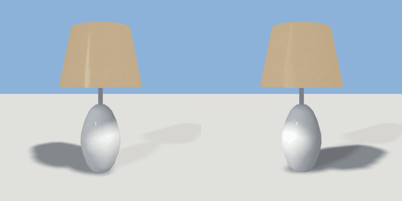

# table_lamp

`asset: table_lamp.yaml` · [source](../../../assets/table_lamp.yaml) · `furniture.lamp` `light.table_lamp`

 

Bedside table lamp: turned ceramic base and a tapered linen shade.
Origin bottom_center.

```yaml
place:
  table_lamp: {asset: table_lamp.yaml, params: {height: 0.55, shade: 0.32}}
```

## Params

| Param | Default | Choices | Notes |
| --- | --- | --- | --- |
| `height` | `0.55` |  |  |
| `shade` | `0.32` |  |  |

## Size

0.32 x 0.55 x 0.32 m (x, y, z); geometry (-0.16, 0, -0.16) to (0.16, 0.55, 0.16) from the origin; 776 triangles

## Parts

`base` (lathe), `stem` (cylinder), `shade` (lathe)

## Light

type omni, color [1,0.93,0.82], energy 0.6, range 3, offset [0,0.43,0]
