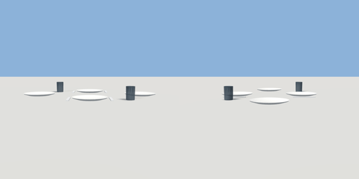

# table_setting

`asset: table_setting.yaml` · [source](../../../assets/table_setting.yaml) · `decor.table_setting`

 

Places laid on a four-seat table (table.yaml, 1.2 x 0.8 m): a plate at each
seat, glasses and cutlery at the long sides. Small parts, no colliders.
Origin: the table top's centre.

```yaml
place:
  table_setting: {asset: table_setting.yaml}
```

## Size

1.15 x 0.1 x 0.83 m (x, y, z); geometry (-0.575, 0.001, -0.415) to (0.575, 0.101, 0.415) from the origin; 1008 triangles

## Parts

`plate_n` (lathe), `plate_s` (lathe), `plate_e` (lathe), `plate_w` (lathe), `glass_n` (lathe), `glass_s` (lathe), `fork_n` (cube), `knife_n` (cube), `fork_s` (cube), `knife_s` (cube)
