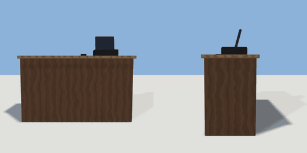

# till_counter

`asset: till_counter.yaml` · [source](../../../assets/till_counter.yaml) · `shop.counter` `furniture.counter`

 

A shop counter with a till: a wooden counter, a till screen and card
reader on top. Staff stand behind it (-Z), customers in front (+Z).

```yaml
place:
  till_counter: {asset: till_counter.yaml, params: {width: 1.6}}
```

## Params

| Param | Default | Choices | Notes |
| --- | --- | --- | --- |
| `width` | `1.6` |  |  |

## Size

1.66 x 1.279 x 0.66 m (x, y, z); geometry (-0.83, 0, -0.33) to (0.83, 1.279, 0.33) from the origin; 732 triangles

## Parts

`body` (cube), `top` (cube), `till` (cube), `screen` (cube), `card_reader` (cube)

## Affordances

stand at (0, 0, -0.75) [staff, shop]

## Clearance

front 1, back 0.8
