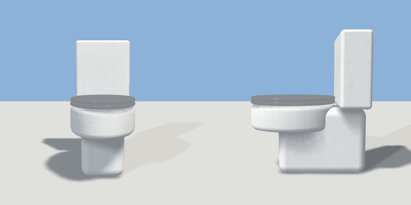

# toilet

`asset: toilet.yaml` · [source](../../../assets/toilet.yaml) · `bathroom.toilet`

 

Close-coupled toilet: pedestal, oval bowl (hollow), seat, lid that lifts
(interaction 'lid') and cistern with a flush button. Back against the wall
(-Z), origin bottom_center.

```yaml
place:
  toilet: {asset: toilet.yaml, state: open}
```

## Size

0.38 x 0.8 x 0.7 m (x, y, z); geometry (-0.18, 0, -0.35) to (0.18, 0.806, 0.33) from the origin; 3202 triangles

## Parts

`pedestal` (cube), `bowl` (extrude), `bowl_cavity` (ellipsoid), `seat` (extrude), `lid` (extrude), `cistern` (cube), `flush` (cylinder)

## Interactions

lid: closed* -> open, open -> closed (* initial; rotates lid)

## Clearance

front 0.6, left 0.2, right 0.2
