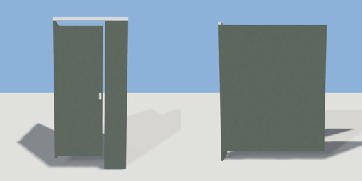

# toilet_stall

`asset: toilet_stall.yaml` · [source](../../../assets/toilet_stall.yaml) · `bathroom.stall`

 

A toilet cubicle: painted side partitions raised off the floor, a front
pilaster and a door that swings out on its left side (press E). The room
archetype puts a toilet under it (room_types/restroom.yaml: under: stall).
Origin: bottom centre; the back is at -Z against the wall, the door at +Z.

```yaml
place:
  toilet_stall: {asset: toilet_stall.yaml, params: {width: 0.95, depth: 1.5}, state: open}
```

## Params

| Param | Default | Choices | Notes |
| --- | --- | --- | --- |
| `width` | `0.95` |  |  |
| `depth` | `1.5` |  |  |

## Size

0.95 x 1.99 x 1.53 m (x, y, z); geometry (-0.475, 0, -0.75) to (0.475, 1.99, 0.78) from the origin; 456 triangles

## Parts

`side_left` (cube), `side_right` (cube), `pilaster` (cube), `head_rail` (cube), `door` (cube), `latch` (cube)

## Interactions

door: closed* -> open, open -> closed (* initial; rotates door, latch)

## Clearance

front 0.8
