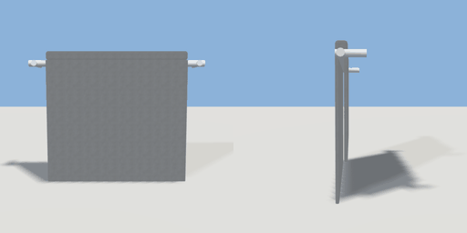

# towel_rail

`asset: towel_rail.yaml` · [source](../../../assets/towel_rail.yaml) · `bathroom.towel_rail`

 

Wall-mounted chrome towel rail with a folded towel over the bar. Origin
bottom-centre on the wall, projects along +Z.

```yaml
place:
  towel_rail: {asset: towel_rail.yaml, params: {width: 0.6}}
```

## Params

| Param | Default | Choices | Notes |
| --- | --- | --- | --- |
| `width` | `0.6` |  |  |

## Size

0.6 x 0.5 x 0.1 m (x, y, z); geometry (-0.3, 0.04, 0) to (0.3, 0.49, 0.082) from the origin; 468 triangles

## Parts

`bracket_left` (cylinder), `bracket_right` (cylinder), `bar` (cylinder), `towel_front` (cube), `towel_back` (cube), `towel_fold` (cube)
