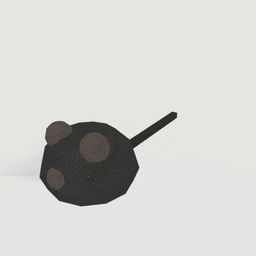
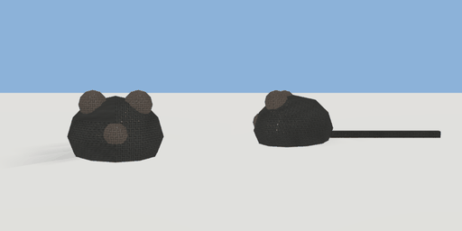

# toy_mouse

`asset: toy_mouse.yaml` · [source](../../../assets/toy_mouse.yaml) · `prop.toy` `toy.cat`

 

A cat's toy: a felt mouse, a small dome with round ears and a string tail.
A carryable physics prop: a cat carries it about in its mouth and drops it
somewhere else (npcs/actions.yaml `play_with`, geogen.100.8). Origin: the
middle of its base; the nose faces +Z.

```yaml
place:
  toy_mouse: {asset: toy_mouse.yaml, params: {colour: graphite}}
```

## Params

| Param | Default | Choices | Notes |
| --- | --- | --- | --- |
| `colour` | `graphite` | text |  |

## Size

0.05 x 0.032 x 0.119 m (x, y, z); geometry (-0.025, 0, -0.093) to (0.025, 0.032, 0.026) from the origin; 468 triangles

## Parts

`body` (lathe), `nose` (sphere), `ear_left` (sphere), `ear_right` (sphere), `tail` (cube)

## Attachments

| Attachment | Position | Facing |
| --- | --- | --- |
| `top` | (0, 0.029, 0) | center |

## Affordances

use at (0, 0.015, 0) [animal, toy]
